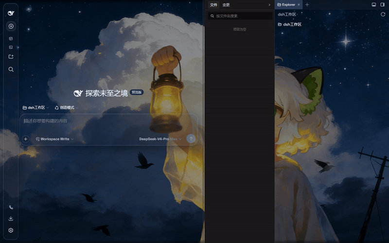
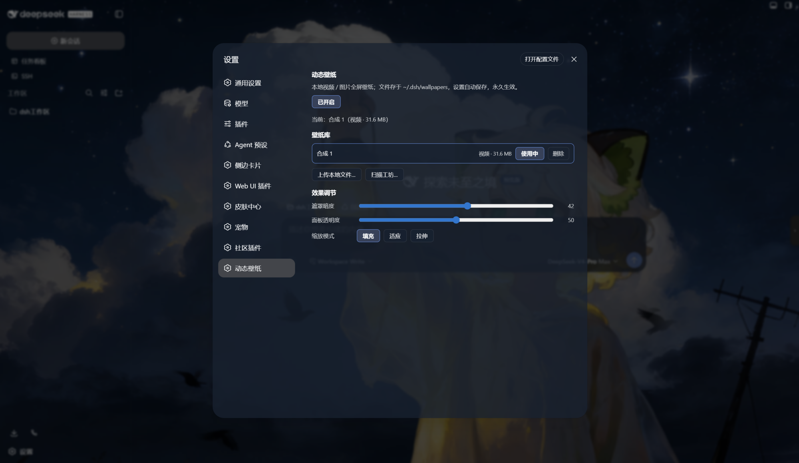

<div align="center">

# 🎨 dsh-wallpaper

## 把你的 wallpaper 动态壁纸用到 DeepSeek Harness 上

把本地视频 / 图片变成 **DeepSeek Harness** 的全屏动态壁纸——效果随时可调、壁纸一键切换、支持 Wallpaper Engine 工坊导入，设置自动保存，**重启不丢**。



[▶️ 查看 30fps 高清演示（MP4）](docs/demo.mp4)


</div>

---

## 🎛️ 设置界面

插件安装后，进入 **设置 → 动态壁纸**，即可完整控制壁纸的展示与效果：



| 区域 | 说明 |
|:---|:---|
| 总开关 | 一键开启 / 关闭壁纸，关闭后界面完全还原 |
| 壁纸库 | 列出 `~/.dsh/wallpapers` 下所有媒体，点选即用、随时删除 |
| 上传 / 导入 | 本地上传视频 / 图片，或扫描 Wallpaper Engine 工坊一键导入 |
| 效果调节 | 遮罩暗度、面板透明度、缩放模式（填充 / 适应 / 拉伸），实时生效 |

所有改动自动保存，**永久生效**。

## ✨ 功能特性

| | |
|:---|:---|
| 🖼️ **全屏动态壁纸** | 视频静音循环播放、图片平铺全屏，位于界面最底层，不挡任何操作 |
| 🎚️ **效果调节** | 遮罩暗度、面板透明度、缩放模式（填充 / 适应 / 拉伸），所见即所得 |
| 🔄 **一键切换** | 壁纸库列表点选即用、随时删除，总开关一键还原界面 |
| 📤 **上传导入** | 本地上传（mp4 / webm / gif / jpg / png / webp，上限 1GB）+ Wallpaper Engine 工坊扫描导入 |
| 💾 **永久保存** | 当前壁纸与效果写入 `~/.dsh/wallpaper-config.json`，重启 dsh、换浏览器都不丢 |
| 🪶 **轻量无依赖** | 不依赖任何仅限 macOS / Linux 的包，Windows 原生可跑 |

## 🚀 安装

**前置**：已装好 DeepSeek Harness（`dsh web` 能正常打开），Node.js ≥ 22.19。

### 一键安装

插件自带 `dsh.bundle` manifest，一条命令即可自动注册，无需再改任何配置：

```bash
dsh plugin --profile web add "github:B-TQ/dsh-wallpaper"
```

未安装 git 时，可直接用 GitHub 打包的源码 tarball：

```bash
dsh plugin --profile web add "https://codeload.github.com/B-TQ/dsh-wallpaper/tar.gz/refs/heads/main"
```

发布到 npm 后，也可直接按包名安装（scoped 名归作者账号所有，不会与其他同名插件冲突）：

```bash
dsh plugin --profile web add @b-tq/dsh-wallpaper
```

安装完成后 **强制刷新浏览器**（`Ctrl + Shift + R`）即可在 设置 → 动态壁纸 中看到插件。

### 手动安装（备选）

1. 把插件源码放到 `~/.dsh/plugins/dsh-wallpaper`
2. 建立链接（Windows 用 junction）：

   ```bash
   mklink /J "%USERPROFILE%\.dsh\profiles\web\node_modules\dsh-wallpaper" "%USERPROFILE%\.dsh\plugins\dsh-wallpaper"
   ```

3. 在 `~/.dsh/profiles/web/package.json` 的 `dependencies` 添加：

   ```json
   "dsh-wallpaper": "link:C:/Users/<你的用户名>/.dsh/plugins/dsh-wallpaper"
   ```

4. 在 `~/.dsh/profiles/web/cordis.patch.yml` 末尾追加：

   ```yaml
   - insert:
       - id: wallpaper
         name: dsh-wallpaper
   ```

5. 重启 dsh，浏览器打开 http://127.0.0.1:3080

## 🎮 使用

进入 **设置 → 动态壁纸**：

- **开关**：一键开启 / 关闭壁纸，关闭后界面完全还原
- **壁纸库**：列出 `~/.dsh/wallpapers` 下所有媒体，「使用」立即切换，「删除」移除文件
- **上传本地文件…**：选择本地视频 / 图片，自动入库并设为当前壁纸
- **扫描工坊…**：扫描 Wallpaper Engine 工坊，点击「导入」复制入库
- **效果调节**：遮罩暗度、面板透明度、缩放模式，改动实时生效

所有改动自动保存，永久生效。

## 🛠️ 配置工坊目录

默认扫描 `D:\steam\steamapps\workshop\content\431960`（Steam 默认位置）。Steam 库在别处时，启动 dsh 前设置环境变量：

```powershell
# PowerShell
$env:DSH_WALLPAPER_WORKSHOP_ROOT = "D:\SteamLibrary\steamapps\workshop\content\431960"
```

```bash
# macOS / Linux
export DSH_WALLPAPER_WORKSHOP_ROOT="$HOME/.steam/steam/steamapps/workshop/content/431960"
```

## 🗑️ 卸载

1. 删除 `~/.dsh/profiles/web/cordis.patch.yml` 中的 `wallpaper` insert 条目
2. 删除 `~/.dsh/profiles/web/package.json` 中的 `dsh-wallpaper` 依赖行
3. 删除链接与 `~/.dsh/plugins/dsh-wallpaper` 源码目录
4. （可选）删除 `~/.dsh/wallpapers` 与 `~/.dsh/wallpaper-config.json`（如需保留壁纸文件请先移走）

## ❓ 常见问题

| 现象 | 原因与解决 |
|:---|:---|
| 设置页「动态壁纸」空白 | 浏览器缓存了旧插件包：**强制刷新**（`Ctrl + F5`）或清站点缓存 |
| 改了代码不生效 | 保持 `lib/client.js` 的 `__ModuleLoader__.load` 注册格式，重启 dsh 后强刷浏览器 |
| Windows 报 EBADPLATFORM | 本插件不依赖仅支持 macOS / Linux 的包，可放心使用 |
| 扫描工坊提示目录不可读 | 未设置 `DSH_WALLPAPER_WORKSHOP_ROOT`，或该路径下没有 `431960` 目录 |

## 🛠️ 开发

```bash
npm run check   # 校验三个入口文件的语法
```

## 📄 许可

[MIT](LICENSE) © dsh-wallpaper contributors
