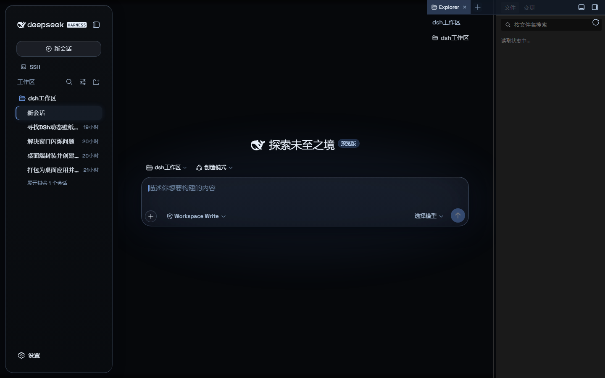

# 把你的 wallpaper 壁纸用到 DeepSeek Harness 上

`dsh-wallpaper` 是 [DeepSeek Harness](https://deepseek.com/harness/)（dsh）的动态壁纸插件：把本地视频 / 图片变成全屏动态壁纸，并且支持效果调节、壁纸一键切换、Wallpaper Engine 工坊导入。所有设置自动保存，**重启 dsh、换浏览器也永久生效**。



## 功能

- **全屏动态壁纸**：视频静音循环播放、图片平铺全屏，位于界面最底层，不挡任何操作
- **效果调节**：遮罩暗度（0–75%）、面板透明度（0–100，半透明透出壁纸）、缩放模式（填充 / 适应 / 拉伸）
- **壁纸切换**：壁纸库列表一键切换、删除；开关总控，关闭后界面完全还原
- **上传与导入**：本地上传（mp4 / webm / gif / jpg / png / webp，上限 1GB）；扫描并导入 Wallpaper Engine 工坊媒体
- **永久保存**：当前壁纸与效果参数写入 `~/.dsh/wallpaper-config.json`，重启不丢

## 环境要求

- DeepSeek Harness `0.1.0-rc.6` 及以上（Windows / macOS / Linux）
- Node.js ≥ 22.19（dsh 的要求）

## 安装

### 方式一：通过 dsh 插件命令（推荐，仓库发布后可用）

```bash
dsh plugin --profile web add "github:<你的用户名>/dsh-wallpaper"
```

### 方式二：手动安装

1. 把插件源码放到 `~/.dsh/plugins/dsh-wallpaper`
2. 建立软链接（Windows 用 junction）：

   ```bash
   # Windows（管理员或开发者模式）
   mklink /J "%USERPROFILE%\.dsh\profiles\web\node_modules\dsh-wallpaper" "%USERPROFILE%\.dsh\plugins\dsh-wallpaper"
   ```

3. 在 `~/.dsh/profiles/web/package.json` 的 `dependencies` 里加一行：

   ```json
   "dsh-wallpaper": "link:C:/Users/<你的用户名>/.dsh/plugins/dsh-wallpaper"
   ```

4. 在 `~/.dsh/profiles/web/cordis.patch.yml` 末尾追加：

   ```yaml
   - insert:
       - id: wallpaper
         name: dsh-wallpaper
   ```

5. 重启 dsh，浏览器打开 http://127.0.0.1:3080

## 使用

进入 **设置 → 动态壁纸**：

- **开关**：一键开启 / 关闭壁纸
- **壁纸库**：列出 `~/.dsh/wallpapers` 下的所有媒体，点击「使用」立即切换，「删除」移除文件
- **上传本地文件…**：选择本地视频 / 图片，自动入库并设为当前壁纸
- **扫描工坊…**：扫描 Wallpaper Engine 工坊目录，列出可导入的媒体，点击「导入」复制入库
- **效果调节**：遮罩暗度、面板透明度、缩放模式（填充 / 适应 / 拉伸）

所有改动实时生效并自动保存。

## 配置 Wallpaper Engine 工坊目录

扫描工坊默认读取 `D:\steam\steamapps\workshop\content\431960`（Steam 默认安装位置）。如果你的 Steam 库在别处，启动 dsh 前设置环境变量即可：

```powershell
# PowerShell
$env:DSH_WALLPAPER_WORKSHOP_ROOT = "D:\SteamLibrary\steamapps\workshop\content\431960"
```

```bash
# macOS / Linux
export DSH_WALLPAPER_WORKSHOP_ROOT="$HOME/.steam/steam/steamapps/workshop/content/431960"
```

## 卸载

1. 删除 `~/.dsh/profiles/web/cordis.patch.yml` 中的 `wallpaper` insert 条目
2. 删除 `~/.dsh/profiles/web/package.json` 中的 `dsh-wallpaper` 依赖行
3. 删除软链接与 `~/.dsh/plugins/dsh-wallpaper` 源码目录
4. （可选）删除 `~/.dsh/wallpapers` 与 `~/.dsh/wallpaper-config.json`

壁纸文件如需保留，请先移走 `~/.dsh/wallpapers` 中的文件。

## 常见问题

### 设置页「动态壁纸」内容空白？

这是浏览器缓存了旧的插件包。请强制刷新：`Ctrl + F5`（或清一下该站点的缓存），再重新打开设置页。

### Windows 上会不会报 EBADPLATFORM？

不会。本插件不依赖仅支持 macOS / Linux 的包，Windows 可直接运行。

### 插件加载失败 / 改了代码不生效？

修改 `lib/client.js` 后请保持 `window.__ModuleLoader__.load({ id: "dsh-wallpaper", factory })` 的注册格式，并重启 dsh 后再强制刷新浏览器。

## 开发

```bash
npm run check   # 校验三个入口文件的语法
```

## 许可

[MIT](LICENSE)
